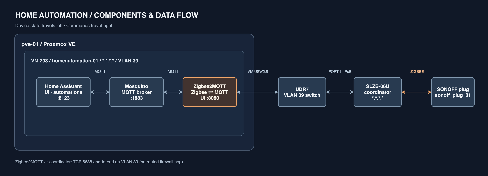

# Home Automation Deployment

## Overview

Home automation stack running on an existing Proxmox homelab server. All services run as Docker containers inside a dedicated Debian 12 VM managed by Proxmox. The Zigbee coordinator is a network-attached device (no USB passthrough required).

---

## Hardware

### Zigbee Coordinator
- Device: **SLZB-06U** (Smlight) — radio TI **CC2652P** (device reports `model: SLZB-06U`, `zb_hw: CC2652P` at `http://*.*.*.*/ha_info`)
- Firmware: Z-Stack (Texas Instruments) coordinator firmware — Zigbee2MQTT adapter `zstack`, not `ember`
- Connection: Ethernet, 802.3af PoE from UDR7 Port 1 (`UDR7 Port 1 - Zigbee`: native network VLAN 39, tagged VLANs blocked)
- Network ports: TCP 6638 (serial-over-network, used by Z2M), HTTP 80 (device web UI)
- Placement: **VLAN 39**, `*.*.*.*` — fixed UniFi DHCP reservation, as confirmed by the owner. The coordinator shares HA's subnet; Z2M → TCP 6638 stays inside the VLAN and needs no firewall rule.
- Physical: keep it 1–2 m+ from the UDR7 — the router is also the 2.4 GHz Wi-Fi AP.

## Proxmox VM

- **OS:** Debian 12 (Bookworm), provisioned via cloud-init.
- **Runtime:** Docker + Compose plugin.
- **Terraform resource:** `proxmox_virtual_environment_vm`.

Sizing and guest identities: [IP addressing](../network/ip-addressing.md).
Deployment and affinity: [VM runbook](../runbooks/homeautomation-vm.md).

---

## Services

All three services are managed by `ansible/roles/homeassistant` and deployed to
`/opt/homeassistant/docker-compose.yml` on VM 203. HA keeps its existing config volume.

### Mosquitto (MQTT broker)
- Image tag: `ansible/roles/homeassistant/defaults/main.yml`.
- Role: routes MQTT publish/subscribe messages between Zigbee2MQTT and Home Assistant; it does not manage Zigbee pairing.
- Port: `1883` bound to `127.0.0.1` on the VM for host-networked HA. Z2M reaches `mosquitto:1883` over Docker's bridge.
- Volumes: `./mosquitto/config` (read-only) and `./mosquitto/data`.
- Anonymous access disabled; three distinct accounts, `z2m`, `homeassistant` and `periscope`, are created by Ansible.

### Zigbee2MQTT
- Image tag: `ansible/roles/homeassistant/defaults/main.yml`.
- Role: pairs Zigbee devices via the SLZB-06U on TCP 6638, then translates their commands and reports to MQTT.
- Depends on Mosquitto; its broker password and Zigbee network key come from vaulted Ansible host variables.
- Data/config volume: `./zigbee2mqtt/data` (included in the VM backup).
- Zigbee radio adapter: `zstack` (TI CC2652P), channel 20. Ansible seeds the PAN IDs and channel on first install; Zigbee2MQTT owns `configuration.yaml` afterward. The network key remains in Ansible-managed `secret.yaml`. Do not regenerate it once devices are paired.
- Frontend: port 8080, published **only to VM loopback**. SSH tunnel procedure: [VM runbook](../runbooks/homeautomation-vm.md).
- Time zone: `Europe/Prague`.

### Home Assistant
- Image tag: `ansible/roles/homeassistant/defaults/main.yml`.
- Install type: **HA Container** (plain Docker container — no Supervisor or add-on store).
- Role: automation engine and UI. One-time MQTT integration: [VM runbook](../runbooks/homeautomation-vm.md).
- Network mode: `host` for mDNS and device discovery.
- Volumes: `./config:/config`, `/etc/localtime` (read-only).
- **No `privileged: true` required** — Zigbee is TCP-based, not USB passthrough.

---

## Docker Compose

Ansible renders the actual Compose file from
`ansible/roles/homeassistant/templates/docker-compose.yml.j2`. HA's web UI
is reachable on VLAN 39; Mosquitto 1883 and the Z2M frontend 8080 bind to VM
loopback. HA (host networking) connects to `localhost:1883`, while Z2M (Docker
bridge) connects to `mosquitto:1883`.

---

## Network / UniFi Notes

### VLAN placement rationale

The VM runs on **VLAN 39** — a dedicated isolated zone, not on VLAN 27.

VLAN 27 has unrestricted inter-zone traffic with VLAN 23 and VLAN 28. Placing HA there would give a compromised VM direct access to the Proxmox host (`*.*.*.*`), TrueNAS (`*.*.*.*`), and family PCs on VLAN 28. HA runs third-party integrations and has a web-facing UI — its blast radius must be contained.

VLAN 39 is a new isolated zone (same policy as IoT/Guest): outbound internet allowed, no unsolicited inbound from other VLANs, cross-VLAN access only via explicit firewall rules.

Address allocations: [IP addressing](../network/ip-addressing.md).

### Required UniFi firewall rules

All cross-VLAN traffic to/from VLAN 39 is denied by default (isolated zone). Add these explicit allow rules:

| Direction | Source | Destination | Port | Purpose |
|---|---|---|---|---|
| Inbound | VLAN 23, 27, 28 | `*.*.*.*` | TCP 8123 | HA web UI |
| Inbound | `*.*.*.*` (monitoring-01) | `*.*.*.*` | TCP 9100 | Prometheus scraping |
| Inbound | management host | `*.*.*.*` | TCP 22 | Ansible SSH |
| Outbound | `*.*.*.*/24` | WAN | TCP 443 | Cloud integrations, updates |

Everything else from VLAN 39 toward internal VLANs is dropped.

No rule is needed for the Zigbee coordinator: Z2M and the SLZB-06U are both on VLAN 39, so TCP 6638 never crosses the firewall. Its web UI (`http://*.*.*.*`) is reachable from internal VLANs through the zone policy `Allow trafic to Isolated` (Internal → Isolated, all ports).

### Proxmox bridge

`vmbr0` must be VLAN-aware with a trunk port to the UniFi switch. Add every guest VLAN to `bridge-vids` before provisioning; see [host network](../runbooks/pve-01-network.md).

---

## Components and message flow

[Editable draw.io source](home-automation-components.drawio).

---

## MQTT credentials and Zigbee network identity

The three MQTT accounts (`homeassistant`, `z2m`, `periscope`) and Zigbee network
key use vaulted secrets in `ansible/inventory/host_vars/homeautomation-01.yml`.
Ansible creates the Mosquitto password file with salted hashes and keeps Z2M's
`secret.yaml` root-readable only. It seeds Z2M's `configuration.yaml` just once:
Zigbee2MQTT writes to this file itself, and subsequent playbook runs must not
overwrite its network state. The broker has `allow_anonymous false`.
Changing a vaulted MQTT password updates the managed broker accounts; changing
the Zigbee network key after devices join requires re-pairing them.

One-time MQTT setup and credential retrieval: [VM runbook](../runbooks/homeautomation-vm.md).

---

## HA Core Limitations vs Supervised

Since this runs HA Core (Docker), the following are relevant:

- No add-on store — Z2M and Mosquitto run as separate Compose services
- No Supervisor UI — upgrade by changing image tags in Ansible and rerunning the playbook
- HACS (community integrations) can still be installed manually
- HA integrations and automations configured in the UI persist in `./config`
- This is intentional: HA Container inside a Debian VM keeps the host generic.
